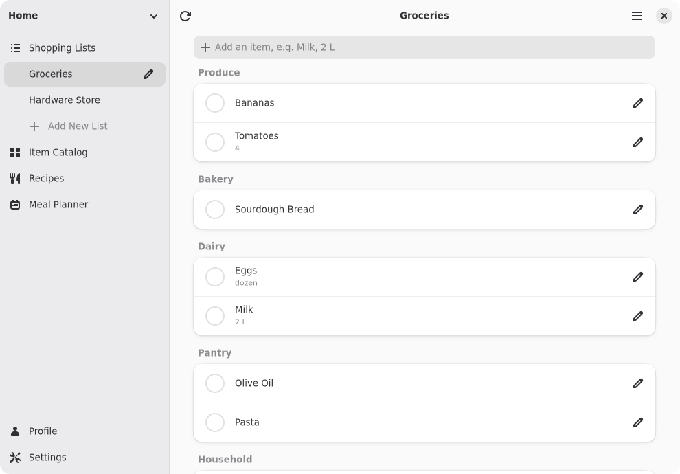
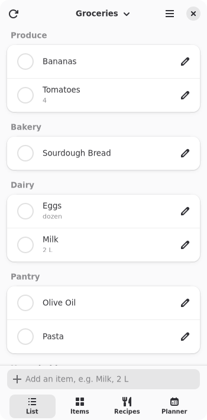
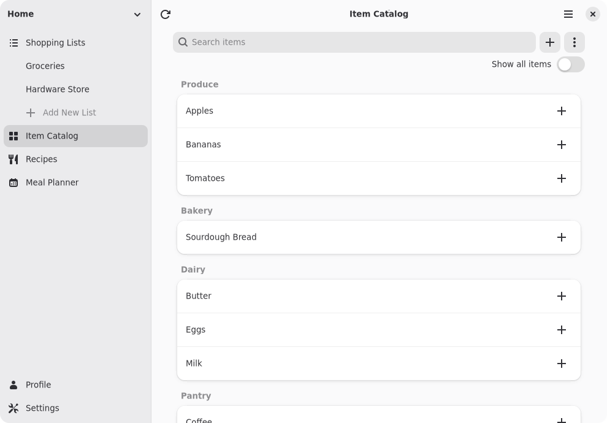

# Owlet

Your household's KitchenOwl shopping lists on your desktop and mobile Linux devices.

Owlet is a native app for [KitchenOwl](https://kitchenowl.org), the self-hosted grocery list and recipe manager. Add what you need in a few keystrokes, tick things off as they go in the cart, and keep shopping even when you have no signal in the store.

## Screenshots

  
  

  

## Features

- **Quick add.** Type "Eggs, dozen" and Owlet adds Eggs with "dozen" as the note. Items you've bought before come up as you type.
- **Check off your way.** Tap an item to check it off, with Undo if you slip, or switch to select mode and check off a handful at once.
- **Recently bought.** Things you bought lately sit below the list, ready to add again with one tap.
- **Sorted for the store.** Group items by category, sort them A to Z, or use the order KitchenOwl has learned from how your household shops.
- **Works offline.** Owlet keeps a copy of your lists on your device, so you can add and check off items without a connection. It syncs the changes to your server when you're back online.
- **Live updates.** When someone else in the household adds or checks off an item, it shows up straight away.
- **Item catalog.** Search everything your household has ever bought, add any item to a list, and rename, recategorize or merge duplicates.
- **Lists, categories and households.** Keep separate lists for different stores, arrange categories in the order you walk the aisles, and switch between households.
- **Fits any screen.** Tabs at the bottom on a phone, a sidebar on a wider window, and a compact view for long lists.
- **Safe sign-in.** Your password is used once to log in and never stored. Owlet keeps only a revocable token in your keyring.

## Installing

### Flatpak (recommended)

| <a href="https://ajdunevent.github.io/AJHub/"><picture><source media="(prefers-color-scheme: dark)" srcset="https://ajdunevent.github.io/AJHub/badges/button-dark.svg"></picture></a> | <a href="https://furihub.github.io/repo/"><picture><source media="(prefers-color-scheme: dark)" srcset="https://furihub.github.io/repo/badges/button-dark.svg"></picture></a> |
| --- | --- |
| x86_64 & aarch64 | aarch64 only |

## What you need

A KitchenOwl server, version 0.7.10 or newer, and an account on it. Owlet signs in with your username and password.

Recipes and the meal planner aren't in Owlet yet. Until they are, Owlet links to them in the KitchenOwl web app.

## Permissions

| Permission | Used for |
| --- | --- |
| `--share=network` | Your KitchenOwl server |
| `--share=ipc`, `--socket=wayland`, `--socket=fallback-x11`, `--device=dri` | Display |

The keyring and opening links use portals.

## Contributing

Bug reports and ideas are welcome on the [issue tracker](https://dev.dunevent.net/aj/Owlet/issues). To build Owlet or work on it, see [DEVELOPING.md](DEVELOPING.md).

Owlet is an independent project and isn't affiliated with KitchenOwl.

## License

GPL-3.0-or-later

The refresh icon is `view-refresh-symbolic` from the [Adwaita icon theme](https://gitlab.gnome.org/GNOME/adwaita-icon-theme) by the GNOME Project, licensed LGPL-3.0-or-later or CC-BY-SA-3.0.
